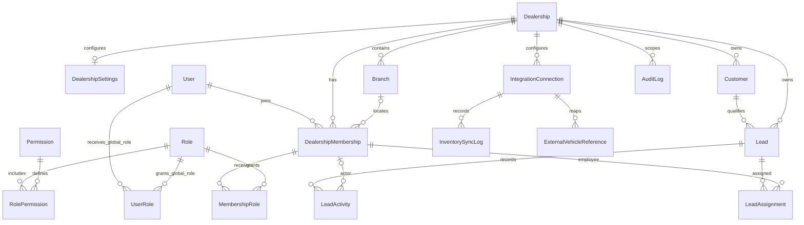

# Database relationships

The principal relationships are represented below. Tenant-bearing foreign keys include `dealershipId` where a child must belong to the same dealership as its parent.

## Tenant-bearing constraints

- `Customer` is keyed by `(dealershipId, id)` for dependent relationships.
- `Lead` references both its dealership and its customer using `(dealershipId, customerId)`.
- `LeadAssignment` references its lead using `(dealershipId, leadId)` and its employee using `(dealershipId, membershipId, userId)`. Its optional assigning membership is also checked within the same dealership.
- `LeadActivity` references its lead using `(dealershipId, leadId)` and its optional actor membership using `(dealershipId, actorMembershipId, userId)`.
- `MembershipRole` carries `dealershipId` in both its membership and role relationships, preventing a role from another dealership from being assigned.
- `InventorySyncLog` and `ExternalVehicleReference` reference their integration with a composite dealership-and-connection key.
- A database check keeps `Role.scope` consistent with whether the role has a dealership. A platform `UserRole` can reference only a global role. A partial unique index prevents duplicate global role keys.

The schema's logical `DealershipMembership` model maps to the pre-existing `UserDealership` table to preserve its physical name.
